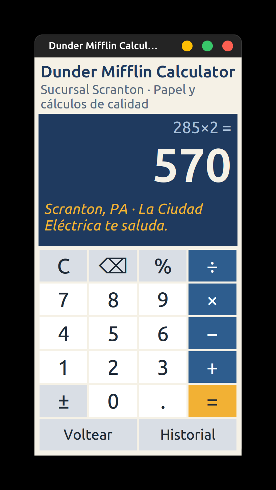
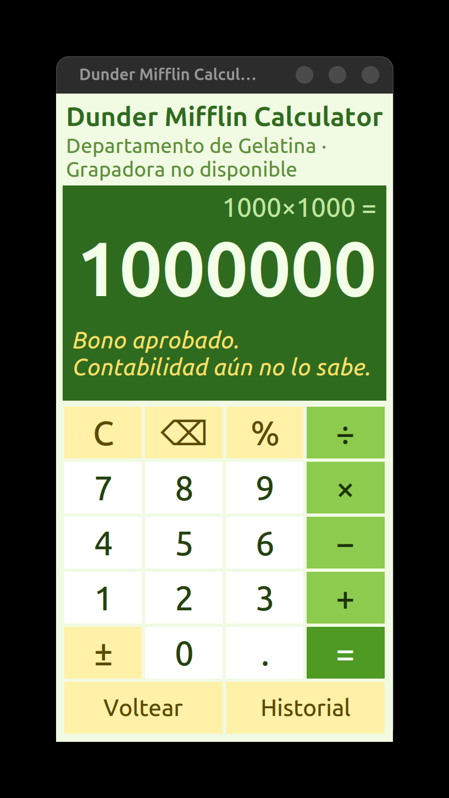
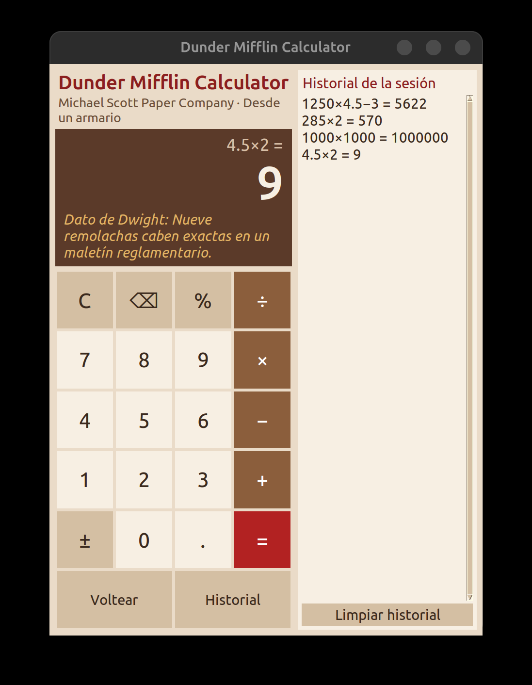

# Dunder Mifflin Calculator

[](https://github.com/programariodev/dunder-calc/actions/workflows/ci.yml)

[](https://github.com/astral-sh/ruff)
[](https://mypy-lang.org/)
[](LICENSE)

Calculadora de escritorio con **tkinter** y temática de *The Office*: papel, azul corporativo y ocho easter eggs escondidos. Sin dependencias externas: solo la biblioteca estándar de Python.

<p align="center">
  
  
  
</p>

## Características

- Suma, resta, multiplicación, división, porcentaje, cambio de signo, borrar y retroceso.
- Aritmética decimal exacta (`0.1 + 0.2 = 0.3`) con un parser propio: **nunca usa `eval()`**.
- Vista previa del resultado mientras escribes e historial de la sesión (doble clic para recuperar).
- Control total por teclado; ventana redimensionable con fuentes que se adaptan.
- Ningún error cierra la aplicación.

## Instalación

Requiere Python 3.10 o superior con tkinter (en Debian/Ubuntu: `sudo apt install python3-tk`).

Con [pipx](https://pipx.pypa.io/) (recomendado, crea un entorno aislado):

```bash
pipx install git+https://github.com/programariodev/dunder-calc.git
dunder-calc
```

O sin instalar nada:

```bash
git clone https://github.com/programariodev/dunder-calc.git
cd dunder-calc
PYTHONPATH=src python3 -m dunder_calc
```

## Teclado

| Tecla | Acción |
|---|---|
| `0`–`9`, `.` o `,` | Números |
| `+` `-` `*` `/` | Operadores |
| `%` | Porcentaje |
| `Enter` o `=` | Calcular |
| `Esc` | Borrar todo (C) |
| `Retroceso` | Borrar último carácter |
| `F` | Voltear la pantalla |
| `H` | Mostrar/ocultar historial |

## Easter eggs

| # | Easter egg | Cómo activarlo |
|---|---|---|
| 1 | Michael opina sobre dividir entre cero | Dividir entre cero |
| 2 | «Scranton, PA» con destello | Resultado `570` |
| 3 | Ventana de bono de fin de año | Resultado `1000000` |
| 4 | Pantalla volteada, apta para RR.HH. | Escribir `5318008` y pulsar **Voltear** (o `F`) |
| 5 | Dato de Dwight sobre la remolacha | Resultado `9` |
| 6 | Tema «Jell-O en la grapadora» | 5 clics en el título en menos de 2 s |
| 7 | Tema Michael Scott Paper Company | ↑ ↑ ↓ ↓ ← → ← → B A |
| 8 | «¡DECLARO BANCARROTA!» | Pulsar C (o `Esc`) 10 veces seguidas |

Los temas 6 y 7 se desactivan repitiendo el gesto. Cada easter egg se apaga en [`config.py`](src/dunder_calc/config.py) (`EasterEggSettings`).

## Desarrollo

```bash
python3 -m venv .venv && source .venv/bin/activate
python -m pip install --upgrade pip
python -m pip install -e . --group dev
pre-commit install

pytest --cov        # pruebas + cobertura
ruff check .        # lint
ruff format .       # formato
mypy                # tipos (modo estricto)
```

La lógica (`core/`) es pura y no importa tkinter, así que las pruebas corren en cualquier entorno. Consulta [CONTRIBUTING.md](CONTRIBUTING.md) para más detalles.

### Arquitectura

```
src/dunder_calc/
├── config.py           límites e interruptores de easter eggs
├── messages.py         todos los textos visibles
├── core/               lógica pura (sin tkinter)
│   ├── engine.py         tokenizador + parser seguro sobre Decimal
│   ├── model.py          estado de la calculadora y reglas de edición
│   ├── keymap.py         teclas y botones → Command
│   ├── transforms.py     cambio de signo, pantalla volteada, eggs por resultado
│   └── detectors.py      código Konami y contador de clics
└── ui/                 interfaz tkinter
    ├── app.py            controlador: une modelo, widgets y easter eggs
    ├── window.py         cuadrícula, tamaño de ventana y escala
    ├── widgets.py        HoverButton, Header, Display
    ├── panels.py         Keypad, HistoryPanel
    ├── eggs.py           efectos de los easter eggs
    ├── theme.py          paletas (Dunder, Jell-O, MSPC)
    ├── fonts.py          fuentes escalables
    ├── animator.py       animaciones cancelables
    ├── dialogs.py        ventana del bono
    └── safety.py         decorador @safe
```

## Aviso

Proyecto de fans sin ánimo de lucro, sin relación con NBCUniversal ni con los creadores de *The Office*. Las frases son originales, inspiradas en la serie.

## Licencia

[MIT](LICENSE) © programariodev
